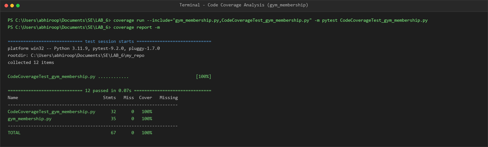
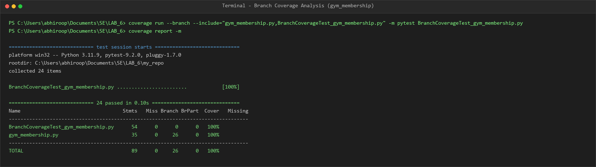

# Lab 6: Code and Branch Coverage Analysis — Gym Membership

This repository contains the solution and coverage analysis for Lab 6: Code and Branch Coverage Analysis.

---

## 1. Objectives & Overview
- Differentiate between **Line Coverage** and **Branch Coverage**.
- Test edge cases, boundaries, and decision structures of `gym_membership.py`.
- Achieve **100% Code Coverage** and **100% Branch Coverage** using `coverage.py` and `pytest`.

---

## 2. Deliverables & Repository Structure

| File | Description |
|---|---|
| [`gym_membership.py`](gym_membership.py) | Application module calculating costs, checking gym entry rules, and determining BMI categories |
| [`test_gym_membership.py`](test_gym_membership.py) | Initial starter test suite |
| [`CodeCoverageTest_gym_membership.py`](CodeCoverageTest_gym_membership.py) | Comprehensive test suite achieving 100% Line/Statement Coverage |
| [`BranchCoverageTest_gym_membership.py`](BranchCoverageTest_gym_membership.py) | Comprehensive test suite achieving 100% Branch Coverage across all decision paths |
| [`CodeCoverage_Report_Screenshot.png`](CodeCoverage_Report_Screenshot.png) | Terminal screenshot demonstrating 100% statement coverage |
| [`BranchCoverage_Report_Screenshot.png`](BranchCoverage_Report_Screenshot.png) | Terminal screenshot demonstrating 100% branch coverage |

---

## 3. How to Run Coverage Analysis

### Step 1: Install Dependencies
```bash
pip install coverage pytest
```

### Step 2: Line / Code Coverage
Run pytest with coverage analysis:
```bash
coverage run --include="gym_membership.py,CodeCoverageTest_gym_membership.py" -m pytest CodeCoverageTest_gym_membership.py
coverage report -m
```

#### Output:
```
============================= 12 passed in 0.07s ==============================
Name                                 Stmts   Miss  Cover   Missing
------------------------------------------------------------------
CodeCoverageTest_gym_membership.py      32      0   100%
gym_membership.py                       35      0   100%
------------------------------------------------------------------
TOTAL                                   67      0   100%
```



---

### Step 3: Branch Coverage
Run pytest with branch coverage analysis:
```bash
coverage run --branch --include="gym_membership.py,BranchCoverageTest_gym_membership.py" -m pytest BranchCoverageTest_gym_membership.py
coverage report -m
```

#### Output:
```
============================= 24 passed in 0.10s ==============================
Name                                   Stmts   Miss Branch BrPart  Cover   Missing
----------------------------------------------------------------------------------
BranchCoverageTest_gym_membership.py      54      0      0      0   100%
gym_membership.py                         35      0     26      0   100%
----------------------------------------------------------------------------------
TOTAL                                     89      0     26      0   100%
```



---

## 4. Key Differences: Line vs Branch Coverage
- **Line Coverage (Statement Coverage)** verifies that every executable line has run at least once. However, having 100% line coverage does not ensure all condition permutations (such as `if` statements taking the `False` fallthrough branch) are tested.
- **Branch Coverage** ensures every branch and condition outcome (`True` and `False`) has been evaluated at runtime, covering edge boundaries and logical paths.
